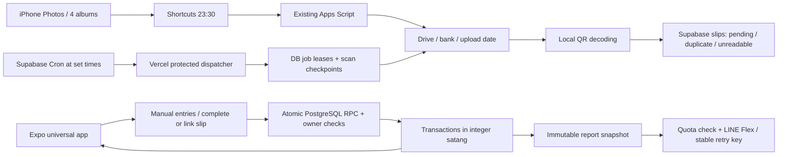

# Architecture and decisions

## Ownership and security

JWT is verified with Supabase Auth before every private API request. Server reads/writes explicitly scope owner_id. Composite foreign keys prevent linking another owner's account/category/slip, even when server uses the service role. Transactions and slip links use authenticated SQL RPCs with `auth.uid()` checks and row locks. Clients cannot call job/LINE/service-only procedures. All personal tables have RLS; secret integration tables have no authenticated client policy.

Private images are downloaded with service-account read-only scope on the server and returned as bounded JPEG after ownership check. They use no public Drive URLs and no browser service-worker cache. Secrets are never included in Expo env or responses. LINE uses the original request body for signature verification; pairing codes are random, hashed, short-lived and single-use.

The v1 service account is bound to `DRIVE_OWNER_ID`. Source configuration, image access and worker downloads reject other owners, so an authenticated second user cannot reuse the primary owner's folder IDs to import private slips. Future multiuser Drive integration requires separately provisioned credentials/authorized source mappings, not just more owner_id rows.

## Durable work

Supabase Cron calls the dispatcher only at set Bangkok times (8 a day): 23:35–00:00 every 5 minutes for the scan after the 23:30 upload, 08:00 reports and an 08:05 retry round; `tests/schedule.test.ts` checks `schedule.sql` against `shouldScan`/`dueReportPeriods`. Only due scan/report work is enqueued. The app's sync button enqueues a scan and runs the same dispatcher at once with a 60-second budget, calling again while import jobs remain; it shares the tick lease, so it never overlaps a scheduled run. A six-minute global lease serializes overlapping ticks beyond Vercel's maximum function duration; four-minute per-job leases recover crashes. Each claim has a token; completion only updates a matching lease. Dispatcher uses a 205-second budget, leaves at least 30 seconds before starting another task and checkpoints scan pages, rechecking remaining time between files. Supabase requests have 15-second timeouts. Work never depends on a process running after the HTTP response.

Scan takes a date range: it lists the bank folder, opens only `YYYY-MM-DD` subfolders inside the range (other subfolders up to two levels, filtered by Drive created date) and stops before the deadline; a rerun is cheap because known file IDs are skipped. Night scans use yesterday–today, never before `profiles.import_from`; the app's "ดึงสลิปตอนนี้" passes any range and source. Slips uploaded in the app (`origin='upload'`) keep no image or Drive ID but store QR key and image hash, so a later Drive copy is marked duplicate by `finish_qr`. Reset (`reset_transactions_and_slips`) deletes the owner's transactions, slips and import jobs and sets `import_from`; `delete_account` refuses accounts with transactions; `delete_category` uncategorizes its transactions. File ID upserts are idempotent; even existing slip rows get the same QR job key, recovering insert-before-enqueue crashes. Subsequent scans list folders for new files but do not process completed images again. One source changed while a scan is running can briefly yield old-source metadata; retrying scan discovers the configured source. Personal volume is the initial target.

Import is bounded to JPEG/PNG/WebP, 12 MB, 24 million input pixels; decoding tries two scales. Hashes identify identical files. Only CRC-valid Mini-QR references identify re-encoded copies; unknown QR payload equality alone never merges different images. Duplication is serialized per owner in SQL and backed by unique canonical indices. No unsupported QR format creates a transaction. No financial values are inferred from upload date, filenames, payment request QR or screenshots.

Job failures retry with exponential delays capped at 60 minutes, then become failed after five actual failures. Partial scan checkpoints do not consume the error retry budget. Exhausted crashed jobs become failed when claimed in the next dispatcher cycle. User retry is available for failed/unreadable slips. Successful scans with no new slips remain distinct from failed scans.

## Reporting

Amounts are integer satang; times are stored as UTC and report boundaries computed in Asia/Bangkok. Spending ("ใช้ไป") is expenses only; transfers between own accounts are summed apart (`Summary.transfers`) and shown on their own home tile and Flex line. Slips with a read amount are saved automatically as `source='auto'`, `needs_review=true` (migration 007). Account charts show cash flow, not balances.

Daily reports are sent at 08:00 for the full previous calendar day. Pending slips count when uploaded from 08:00 that day until 08:00 the report morning, so the 23:30 upload and late uploads are visible exactly once. Unreviewed OCR amounts are listed separately and never added to totals. OCR (Tesseract.js, models and wasm bundled in `dist/`) runs on Vercel right after QR in each night scan and from the app's buttons; PaddleOCR on GitHub Actions is a manual backup. The app records expenses and own-account transfers only; income is not offered. Weekly/monthly ranges include complete calendar periods. The daily LINE report is a cutoff snapshot; dashboard and in-app reports use latest entries/full day. Snapshot retry never recomputes or resends after manual corrections. UUID retry keys cover LINE's 24-hour window; uncertain older deliveries stop automatically. Database uniqueness on owner/report_key prevents another report record for the same period.

## API

All private endpoints require `Authorization: Bearer <Supabase access token>`.

| Endpoint | Purpose |
|---|---|
| GET `/api/data` | Initial owner dataset, paginated DB reads |
| GET `/api/transactions` | UTC start/end, account/category, page/size |
| PUT/DELETE `/api/transactions/:uuid` | Validated owner mutation, client UUID for retry |
| GET `/api/dashboard?start=...&end=...` | Summary |
| POST `/api/slips/:uuid/link` | Atomic link to existing transaction |
| GET `/api/slips/:uuid/image` | Private bounded image |
| POST `/api/slips/:uuid/retry` | Reset a QR job |
| POST `/api/sync` | Queue scans for a date range/source, save earlier readable drafts, run scan/QR jobs only (~60 s, no LINE) |
| POST `/api/sync/run` | Continue a manual import |
| GET `/api/sync/status?since=` | Progress: pending/done jobs, slips found, auto-saved |
| POST `/api/sync/cancel` | Drop queued scan/QR jobs |
| POST `/api/slips/upload` | Photo upload: QR + OCR, auto-save when the amount is read, no image kept |
| POST `/api/transactions/:uuid/reviewed` | Clear the auto-save review flag |
| PATCH/DELETE `/api/accounts/:uuid`, `/categories/:uuid`; PATCH `/api/accounts/:uuid/numbers`; DELETE `/api/rules/:uuid` | Edit/delete setup |
| POST `/api/reset` | Delete transactions and slips, set the import start date |
| POST `/api/line/test` | Today so far, not stored |
| POST `/api/line/import-summary` | One Flex for days just imported, not stored |
| PUT `/api/sources/:code` | Folder + actual-account mapping |
| POST `/api/accounts`, `/categories`, `/rules` | Configuration |
| PATCH `/api/settings` | Budget, own names, import start date, quick-entry shops |
| POST `/api/line/link-code` | Pairing command, valid five minutes |
| DELETE `/api/line/connection` | Disconnect owner |
| GET `/api/export?start=...&end=...` | Formula-escaped owner-only CSV |
| POST `/api/internal/tick` | CRON_SECRET, service-only dispatcher |
| POST `/api/line/webhook` | HMAC-verified LINE events |

## Deployment boundary

Code, migrations, adapter and Cloud schedule are delivered. Real cloud accounts, credentials, real bank-slip fixtures and phone devices are not available in this implementation session; no cloud deployment or actual LINE push has been performed. Self-signup is deliberately absent. Native store distribution and multiuser service provisioning are later work.
